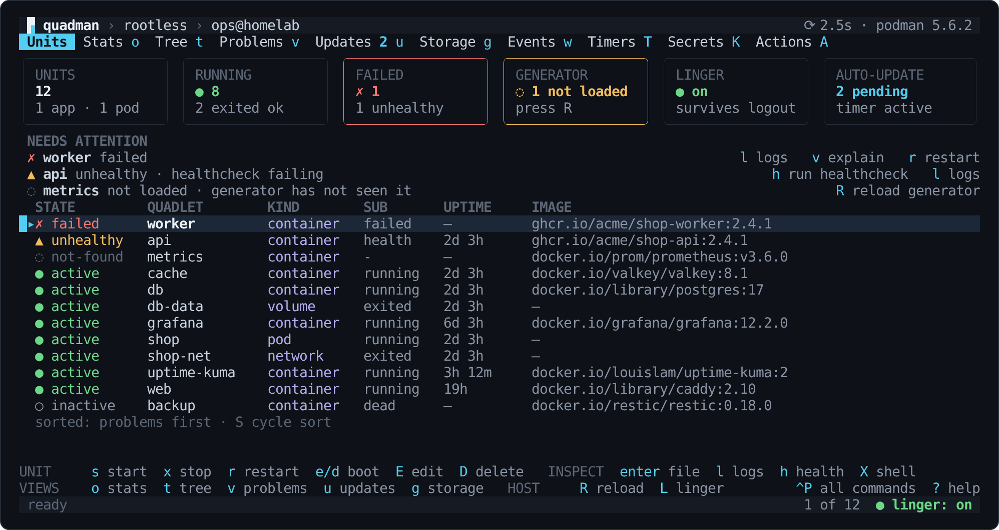
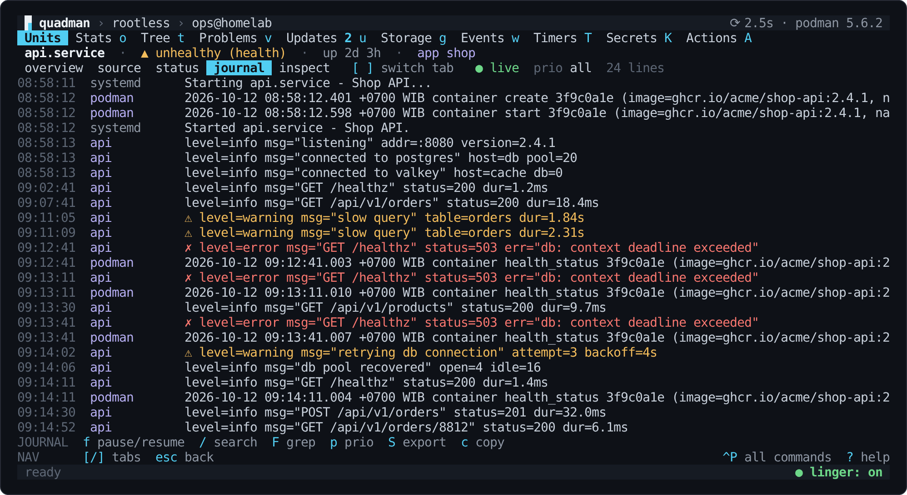
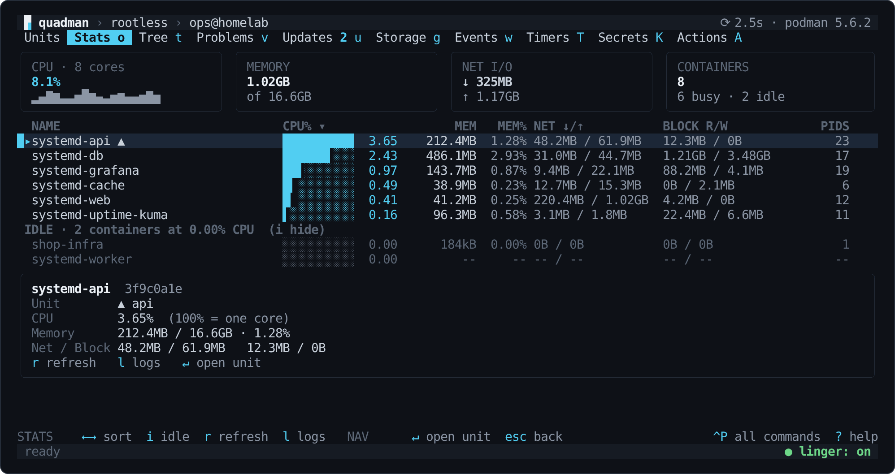

<div align="center">

<picture>
  <source media="(prefers-color-scheme: dark)" srcset="docs/logo/quadman-logo-dark.svg">
  
</picture>

**Terminal UI untuk unit Podman [Quadlet](https://docs.podman.io/en/latest/markdown/podman-systemd.unit.5.html) — rootless-first, dengan mode sistem
rootful, host remote lewat SSH, dan kompartemen per user.**

---

<p align="center">
  <a href="README.md"><b>English</b></a> | <a href="README.id.md"><b>Bahasa Indonesia</b></a>
</p>

[](https://github.com/fahmikemal/quadman/actions/workflows/ci.yml)
[](https://github.com/fahmikemal/quadman/releases)
[](https://pkg.go.dev/github.com/fahmikemal/quadman)
[](https://golangci-lint.run/)
[](LICENSE)

</div>

Quadlet adalah standar yang direkomendasikan untuk menjalankan container rootless sebagai systemd service — namun perkakas bawaannya tersebar di antara `systemctl`, `journalctl`, dan `loginctl`. quadman menyatukan seluruh siklus hidup tersebut dalam satu TUI terpadu:

- Mendeteksi setiap berkas sumber Quadlet yang dibaca oleh generator systemd (`*.container`, `*.pod`, `*.kube`, `*.volume`, `*.network`, `*.image`, `*.build`, `*.artifact`), di seluruh hierarki direktori pencarian pengguna (`$XDG_RUNTIME_DIR/containers/systemd` → `~/.config/containers/systemd` → `/etc/containers/systemd/users[/UID]` → `/usr/share/containers/systemd/users[/UID]`), termasuk subdirektorinya, dengan mekanisme shadowing (*first-match*) yang identik dengan generator resmi Podman.
- Memetakan setiap berkas sumber ke unit systemd yang dihasilkan oleh generator (`webapp.container` → `webapp.service`, `stack.pod` → `stack-pod.service`, `cache.volume` → `cache-volume.service`, dst.), menghargai override `ServiceName=` dan template unit (`web@.container` → `web@.service`).
- Menampilkan status live secara real-time (active/inactive/failed, `not-found` saat Anda lupa melakukan `daemon-reload`) beserta image yang dikonfigurasi langsung di tabel utama — di-refresh secara otomatis setiap beberapa detik dengan posisi kursor tetap terkunci pada baris pilihan Anda.
- Operasi `start` / `stop` (dengan konfirmasi aman — Quadlet menjalankan container dengan opsi `--rm`) / `restart` / `enable` / `disable` / `daemon-reload` cukup dengan satu tombol cepat, masing-masing disertai indikator animasi spinner saat operasi berjalan; start pertama yang lambat (pull image besar) ditunggu hingga 5 menit lalu dilaporkan masih berjalan, bukan gagal.
- Memberikan peringatan (*warning banner*) jika berkas quadlet mengalami modifikasi setelah `daemon-reload` terakhir, sehingga Anda tidak lagi bingung mengapa perubahan konfigurasi belum aktif — langsung dari `NeedDaemonReload` milik systemd, sehingga tetap benar via SSH dan di kompartemen.
- **Follow-mode journals** — streaming live `journalctl -f` per unit dengan fitur auto-scroll ke baris terbawah (*stick-to-tail*), jeda streaming (`f`), live grep filter (`F`), filter prioritas log (`p`), ekspor ke `.log`/`.jsonl` (`S`), dan salin log ke clipboard via OSC52 (`c`).
- **Command Palette** (`Ctrl+P`) — modal overlay berbasis pencarian fuzzy untuk menemukan dan mengeksekusi semua aksi siklus hidup unit, navigasi layar/view, diagnostik, dan perintah kustom (*custom commands*) dengan validasi status kontekstual secara langsung.
- **Native Wish SSH Daemon** (`quadman serve`) menyajikan antarmuka TUI langsung melalui protokol SSH tanpa perlu menginstal quadman di mesin klien penghubung: bind loopback saja secara default, `authorized_keys` wajib untuk bind non-loopback, lengkap dengan autentikasi public key, autentikasi password (hanya loopback, dengan pembatasan percobaan), pembuatan host key otomatis, mode dashboard *read-only*, dan sesi yang sepenuhnya terisolasi.
- **Mode Ganda Rootless & Sistem** (`--system`) — identitas utama tetap memprioritaskan rootless secara bawaan, namun mendukung penuh manajemen unit tingkat sistem (*rootful*) (`/etc/containers/systemd`, `/run/containers/systemd`) serta deteksi otomatis hak akses root (`sudo quadman`); `system: true` di config.yaml menjadikannya default.
- **Host remote** (`--ssh user@host`) — seluruh TUI (dan `list`) terhadap mesin lain lewat `ssh` milik Anda: satu koneksi multiplex, setiap perintah di-quote untuk shell remote, tanpa memasang atau menyinkronkan apa pun di host.
- **Kompartemen** (`--as svc-web`) — kelola Quadlet milik OS user lain (search path, user manager, storage podman, dan secret miliknya) lewat sudo non-interaktif, dengan aturan sudoers yang hanya mendaftar CLI yang dijalankan quadman.
- **Aman sejak desain** — satu kebijakan kapabilitas menentukan apa yang boleh dilakukan setiap sesi (readonly, SSH, kompartemen, serve); konfirmasi menyebut apa yang akan terjadi dan apa yang tetap, dan apa pun yang menghilangkan data (unit, volume, secret, prune) menunggu namanya diketik.
- Pencarian fuzzy `/` untuk memfilter daftar unit secara instan saat Anda mengetik.
- Mengedit berkas quadlet langsung di editor teks `$EDITOR` bawaan Anda dari dalam TUI; otomatis memberikan peringatan untuk me-reload generator setelah berkas disimpan.
- **Layar auto-update** (`u`) — preview `podman auto-update --dry-run` dan status timer `podman-auto-update.timer`, dapat diaktifkan/dinonaktifkan langsung dengan `U`.
- Pemantauan kesehatan container (*healthcheck*): container yang tidak sehat (*unhealthy*) langsung ditandai di kolom STATE, dan tombol `h` mengeksekusi `podman healthcheck run` pada unit yang dipilih. Container ditemukan lewat label `PODMAN_SYSTEMD_UNIT` milik Quadlet, sehingga override `ContainerName=` dan `ServiceName=` langsung bekerja.
- **Validasi bawaan (*built-in validation*)** — generator Quadlet resmi dijalankan secara *dry-run* untuk memvalidasi setiap berkas saat startup dan setelah setiap `daemon-reload` (di host SSH, atau sebagai user kompartemen, bila sesinya remote); unit yang bermasalah ditandai dengan ✗/⚠ dan layar `v` menjelaskan detail error secara gamblang, termasuk deteksi versi Podman (*version-gating hints*).
- **Direktori Drop-in** — mendukung berkas konfigurasi tambahan `foo.container.d/*.conf` (termasuk *cascading* `foo-.container.d/` dan drop-in generik `container.d/`) yang ditampilkan menyatu (*merged*) sesuai urutan evaluasi generator systemd.
- **Pohon dependensi (*dependency tree*)** (`t`) — unit dikelompokkan per pod dan per app podman, masing-masing dengan pod, image, network, volume, dan dependensi `[Unit]` yang dirujuknya. Referensi yang hilang ditandai `✗ missing`, subtree yang sehat dimulai terlipat (`←/→`, `z` semua), `f` hanya menampilkan yang bermasalah, dan `i` menambah baris *impact* (apa yang memblokir unit, dan siapa yang membutuhkannya).
- Dukungan mouse: klik baris untuk memilih, putar roda mouse untuk menggulir log; `y`/`Y` untuk menyalin nama unit/image ke clipboard via protokol OSC52 (berfungsi mulus bahkan melalui koneksi SSH).
- **Panel detail bertab** (`[`/`]`) — ringkasan (*overview*: status, restart, result, boot, port, volume, secret, dependensi, masalah), kode sumber, `systemctl status`, live journal berkolom waktu/sumber/pesan dengan level berupa glyph + warna, dan `podman inspect`.
- **Dashboard** — enam tiles (units, running, failed, generator, linger, auto-update) dan blok "needs attention" yang menyebut setiap masalah beserta tombol untuk memperbaikinya; masalah selalu berada di urutan teratas tabel.
- **Storage** (`g`) — `podman system df` sebagai tiles, lalu images, volumes, dan containers sebagai tab, masing-masing ditautkan ke unit quadlet yang memakainya; objek yang tidak terpakai dikelompokkan di bawah UNUSED beserta ruang yang bisa di-reclaim. Pull, remove (ditolak selama masih dipakai unit), dan prune, semuanya lewat konfirmasi; menghapus volume atau prune menunggu namanya (atau `prune`) diketik.
- **Events** (`w`) — satu timeline live yang menggabungkan `podman events`, pesan service manager tentang unit Anda (started, failed, scheduled restart), dan aksi quadman sendiri; filter tipe (`1`-`6`), unit (`u`), dan rentang waktu (`s`), jeda (`f`), ekspor (`S`).
- **Timers** (`T`), **Secrets** (`K`), **Actions** (`A`) — jadwal dalam bahasa manusia dengan riwayat 24 run ✓✗; unit mana memakai secret apa dan sebagai apa, dengan nilai yang tidak pernah dirender (input bermasker lewat stdin, clipboard dibersihkan setelah 30 detik); audit sesi dengan durasi, pemicu, perintah setara, dan tombol untuk mengulang (pengulangan meminta konfirmasi aslinya lagi dan tidak pernah diputar ke sesi lain).
- **Petunjuk pintar (*smart hints*)** — jika start unit berstatus `timed-out`, TUI menyarankan penyesuaian `TimeoutStartSec=` atau `Pull=`; peringatan *crash-loop* dan pemakaian `AutoUpdate=` tanpa timer aktif juga langsung disorot pada layar diagnostik masalah.
- **Generator dari perintah apapun** (`n`) — salin-tempel perintah `docker run` atau jalur berkas docker-compose; utilitas [podlet](https://github.com/containers/podlet) akan mengonversinya, Anda dapat meninjau preview hasilnya, lalu tekan `y` untuk menulis berkas (secara atomik, ke `~/.config/containers/systemd`, atau `/etc/containers/systemd` di mode sistem) dan memicu reload generator secara otomatis.
- **Template & Bundel** — instansiasi template `web@.container` menjadi `web@prod.service` (`i`), serta preview dan instalasi bundel multi-dokumen `.quadlets` (`I`).
- Pengayaan data opsional melalui `podman quadlet list` (pengelompokan aplikasi/pod) jika binary podman terpasang di host; tetap berfungsi penuh 100% tanpa ketergantungan podman socket.
- **Indikator & Pengontrol Linger Pengguna** — `loginctl enable-linger` adalah satu konfigurasi krusial yang wajib dimiliki server container rootless (tanpa linger, container Anda akan mati saat user logout). quadman menampilkan status linger di bar navigasi bawah dan memungkinkan toggle status dengan satu tombol `L`.

quadman dirancang secara sengaja bersifat *engine-agnostic*: hanya memanggil CLI `systemctl --user` / `journalctl --user` / `loginctl`, sehingga kompatibel dengan semua instalasi Podman rootless dan sama sekali tidak membutuhkan daemon atau socket API Podman yang berjalan di latar belakang.

## Tangkapan Layar (Screenshots)

Tampilan daftar utama — tile dashboard, blok *needs attention* yang menyebutkan tombol untuk memperbaiki tiap masalah, lalu seluruh Quadlet beserta status aktif, uptime, dan image-nya (masalah selalu diurutkan paling atas):



Tekan `l` pada sebuah unit untuk streaming journal secara real-time (`journalctl -f`) tanpa keluar dari TUI — baris warning dan error ditandai, jeda dengan `f`, cari dengan `/`, saring berdasarkan prioritas dengan `p`:



Penggunaan resource per kontainer (`podman stats`, tombol `o`) lengkap dengan riwayat CPU, dan setiap kontainer terhubung ke unit Quadlet-nya:



## Instalasi

Unduh binary siap pakai (Linux amd64/arm64) dari halaman [Releases](https://github.com/fahmikemal/quadman/releases):

```sh
curl -LO https://github.com/fahmikemal/quadman/releases/download/v0.7.0-beta.1/quadman_0.7.0-beta.1_linux_amd64.tar.gz
tar -xzf quadman_0.7.0-beta.1_linux_amd64.tar.gz && sudo install quadman /usr/local/bin/
```

Atau menggunakan Go:

```sh
go install github.com/fahmikemal/quadman@v0.7.0-beta.1
```

Sebutkan versinya untuk sementara: sampai `v0.7.0` dirilis, `@latest` masih
mengarah ke rilis lama yang sudah ditarik (retracted) dan tetap tersimpan di
cache proxy modul Go.

Atau kompilasi langsung dari repositori:

```sh
make build   # ./quadman
```

Kebutuhan sistem: Linux dengan systemd, sesi pengguna (*user session* untuk mode rootless), dan `journalctl` untuk penampil log. Tanpa daemon latar belakang; mendukung satu berkas konfigurasi YAML opsional (lihat bagian Konfigurasi di bawah). Opsional, per fitur:

| Fitur | Butuh |
| ----- | ----- |
| pengelompokan app/pod, health, storage, secrets, stats, events | `podman` 5.3+ (disarankan 6.x) |
| layar problems (dry-run generator) | `podman-system-generator` (terpasang bersama podman) |
| generate `n` | [`podlet`](https://github.com/containers/podlet) |
| `--ssh user@host` | client `ssh` Anda; login shell kompatibel POSIX di host |
| `--as <user>` | sudo non-interaktif ke user tersebut (root, atau aturan `NOPASSWD:SETENV` — lihat Kompartemen) dan runtime dir untuknya |

Build dari source butuh Go 1.26.8 atau lebih baru.

## Penggunaan

```sh
quadman                          # Buka antarmuka TUI (sesi user rootless secara default)
quadman --system                 # Mode tingkat sistem / rootful (/etc/containers/systemd)
sudo quadman                     # Deteksi otomatis root dan mengaktifkan mode sistem
quadman serve                    # Jalankan TUI sebagai SSH server via Wish daemon (default 127.0.0.1:2222)
quadman serve -p 2222 --readonly # Dashboard monitoring SSH mode baca-saja
quadman --readonly               # TUI dengan seluruh aksi pengubah status dinonaktifkan
quadman --ssh user@host          # Kelola server remote rootless melalui koneksi SSH
quadman --ssh user@host list     # Ringkasan non-interaktif host remote
quadman --theme colorblind       # Pilihan tema: auto, dark, light, atau colorblind
quadman --mouse                  # Aktifkan navigasi klik mouse
quadman --quadlet-dir ~/quadlets # Direktori sumber Quadlet tambahan (dapat diulang)
quadman list                     # Output daftar non-interaktif untuk integrasi script/piping
quadman --system list            # Tampilkan daftar quadlet tingkat sistem (flag ditulis sebelum perintah)
quadman --as svc-web list        # Daftar unit milik user lain via sudo (flag ditulis sebelum perintah)
quadman --skill                  # Ekspor spesifikasi Agent Skill untuk AI (markdown)
quadman --skill --skill-format=json # Ekspor spesifikasi Agent Skill dalam format JSON
quadman --ascii                  # Glyph status ASCII (otomatis di TERM=linux)
quadman -version                 # Splash logo blok di terminal, satu baris saat di-pipe
```

### Tombol Navigasi (Keybindings)

| Tombol | Aksi |
| ----- | --------------------------------------------- |
| `↑/↓` `j/k` | Berpindah navigasi pada daftar baris |
| `enter` | Melihat isi berkas sumber Quadlet |
| `Ctrl+P` | Command Palette (pencarian fuzzy dan eksekusi aksi unit, termasuk pull image, atau perintah kustom) |
| `/` | Filter fuzzy daftar unit (ketik untuk menyaring, `esc` untuk menghapus filter) |
| `l` | Live journal tail (`f` jeda, `/` cari, `F` grep filter, `p` prioritas, `S` ekspor, `c` salin) |
| `s` / `x` / `r` | Start / stop (dengan konfirmasi) / restart unit — atau seluruh unit yang ditandai dengan `space` |
| `space` | Tandai/lepas tanda baris untuk aksi massal (*bulk actions*, `esc` untuk membersihkan tanda) |
| `e` | Aktifkan saat boot (*enable*, menambah `WantedBy=default.target` — `multi-user.target` di mode sistem — ke `[Install]`, dengan konfirmasi) |
| `d` | Nonaktifkan saat boot (*disable*, menghapus key boot dari `[Install]` dan mempertahankan sisanya, dengan konfirmasi) |
| `E` | Mengedit berkas Quadlet menggunakan `$EDITOR` |
| `X` | Buka `/bin/sh` di kontainer unit (`podman exec`, pencocokan nama persis; tidak via SSH atau di sesi serve) |
| `u` | Layar auto-update (`U` untuk toggle status timer otomatis) |
| `h` | Menjalankan `podman healthcheck` pada unit yang dipilih |
| `v` | Layar diagnosa masalah — validasi generator terhadap seluruh berkas Quadlet |
| `t` | Pohon dependensi (*dependency tree*: pods, images, networks, volumes, dependensi `[Unit]`) |
| `i` | Instansiasi template unit (`web@.container` → `web@prod.service`) |
| `D` | Hapus unit (menghentikan kontainer dan menghapus berkas sumber; ketik nama unit untuk konfirmasi) |
| `y` / `Y` | Salin nama unit / image ke clipboard (OSC52, bekerja sempurna via SSH) |
| `[` / `]` | Berpindah tab detail: overview / source / status / journal / inspect |
| `I` | Pasang bundel `.quadlets` (`podman quadlet install`) |
| `g` | Storage: images / volumes / containers dengan USED BY (`[ ]` tab, `p` pull, `D` hapus — volume wajib diketik namanya, `S` urutan) |
| `o` | Statistik resource: bar CPU, urutkan dengan `←/→`, `i` container idle, sampling ulang otomatis |
| `P` | `podman system prune` (ketik `prune` untuk konfirmasi; peringatan untuk unit Quadlet nonaktif) |
| `T` | Timers: jadwal, next/last run, riwayat run (`n` jalankan sekarang, `s`/`x`, `e`/`d`, `l` log run terakhir) |
| `K` | Secrets: USED BY · AS, yang hilang dan tidak terpakai di atas (`n` buat, `r` rotasi, `c` salin nilai, `D` hapus) |
| `w` | Timeline event (`f` jeda, `1`-`6` tipe, `u` unit ini, `s` rentang waktu, `S` ekspor) |
| `n` | Generator quadlet via podlet (`podman run ...`, `docker run ...`, singkatan `run ...`, `compose <path>`, atau `<kind> <name>` untuk container\|pod\|network\|volume\|image) |
| `A` | Aksi sesi: hasil, durasi, pemicu, perintah (`.` ulangi dengan konfirmasi aslinya, `c` salin perintah) |
| `S` | Ganti urutan daftar: masalah dulu / nama / kind |
| `z` | Lipat atau buka tiles dashboard |
| `R` | `systemctl --user daemon-reload` (`systemctl daemon-reload` di mode sistem; regenerasi unit setelah berkas Quadlet diedit) |
| `L` | Toggle linger (`loginctl enable-linger`) untuk user sesi itu sendiri — Anda, user login remote, atau user kompartemen |
| `?` | Buka bantuan tombol (*help overlay*) |
| `q` / `esc` | Keluar / kembali ke layar sebelumnya |

## Konfigurasi

Pengaturan YAML opsional terletak di `~/.config/quadman/config.yaml` (seluruh opsi bersifat opsional). Berkas dibaca secara ketat dan *fail closed*: berkas rusak atau key tak dikenal (salah ketik seperti `read_only:`) dilaporkan, TUI mulai dalam mode **readonly** sampai diperbaiki, dan `quadman serve` menolak berjalan — quadman tidak pernah menebak pengaturan yang menentukan siapa boleh mengubah apa.

```yaml
refresh_interval: 5s   # Interval polling daftar (default 2.5s; 15s saat idle/tidak fokus)
log_tail: 200          # Jumlah baris awal snapshot journal saat membuka log
log_buffer: 1000       # Batas maksimum baris buffer penampil log
readonly: false        # Sama dengan flag quadman --readonly
theme: auto            # auto, dark, light, atau colorblind
mouse: false           # Sama dengan flag quadman --mouse (off menjaga seleksi teks terminal tetap aktif)
dashboard: true        # false membuat daftar dimulai dengan tiles terlipat (z untuk toggle)
system: false          # true: kelola unit sistem secara default (seperti --system; tidak berlaku untuk --as)
ssh_multiplex: true    # --ssh berbagi satu koneksi (OpenSSH ControlMaster); false untuk menonaktifkan
quadlet_dirs:          # Direktori sumber Quadlet tambahan (sama dengan --quadlet-dir)
  - ~/quadlets
serve:
  authorized_keys: ~/.ssh/authorized_keys # wajib untuk bind non-loopback
  # address: 127.0.0.1:2222 # default; 0.0.0.0:2222 untuk LAN (butuh authorized_keys)
  # port: "2222" # ringkas bila address kosong (loopback)
  # host_key: ~/.config/quadman/host_ed25519 # default; dibuat otomatis bila hilang
  # password_file: /run/secrets/quadman-pass # atau password: ... (salah satu saja)
  # readonly: false # sajikan sesi read-only

custom_commands:
  - name: status
    key: C
    run: systemctl --user status {{.UnitName}}
  - name: image
    key: M
    run: podman image inspect {{.Image}}
```

Tombol kustom tidak boleh memakai tombol bawaan mode daftar
(`/ ? A d D e E g h i I l L n o P q r R s S t T K u v w x X y Y z` dan spasi):
quadman memberi peringatan saat startup bila ada perintah kustom yang tertutup (*shadowed*), karena tombol bawaan selalu menang. Perintah kustom pada tombol navigasi tabel (`j k b f g G u d`) tetap berjalan tetapi mengambil alih tombol navigasi tersebut; quadman juga memberitahukannya saat startup.

Perintah kustom (*custom commands*) dijalankan tanpa perantara shell: string `run` lebih dulu dipecah menjadi kata dengan tokenizer yang menghormati tanda kutip, lalu setiap kata diekspansi sebagai template Go (`{{.Name}}`, `{{.UnitName}}`, `{{.Kind}}`, `{{.Image}}`), sehingga nilai dari file unit tetap berada di dalam kata tempatnya ditulis dan tidak pernah bisa menambah argumen. Perintah berjalan lewat sesi — di host SSH atau sebagai user kompartemen, sama seperti aksi bawaan — dan hasilnya tampil di bar status bawah serta tercatat di log aksi terakhir (`A`). Preferensi editor teks saat pertama kali dipilih disimpan pada berkas `config.json` di direktori yang sama.

## Mode SSH Remote

```sh
quadman --ssh user@host
```

Setiap pemanggilan CLI (`systemctl`, `journalctl`, `loginctl`, `podman`) diteruskan melalui binary `ssh` lokal Anda — SSH key, ssh-agent, `known_hosts`, dan konfigurasi `~/.ssh/config` langsung bekerja otomatis tanpa perlu setup tambahan. Jika `ssh user@host true` berhasil, quadman dipastikan langsung bekerja. Pemanggilan berbagi satu koneksi multiplex (OpenSSH `ControlMaster` dengan socket privat, ditutup saat quadman keluar), sehingga satu refresh hanya butuh satu handshake, bukan satu per perintah; set `ssh_multiplex: false` untuk menonaktifkan. OpenSSH menyerahkan satu baris perintah ke login shell remote, jadi quadman meng-quote setiap kata: login shell remote harus kompatibel POSIX (sh, dash, bash, zsh, ksh).

Mode remote mempertahankan kendali penuh untuk operasi baca dan siklus hidup: daftar unit (juga `quadman --ssh user@host list`), status live, start / stop / restart, instansiasi template, journal logs, storage, stats, events, auto-update, healthcheck, linger (untuk user login remote), problems (dry-run generator milik host), banner stale-reload, install bundel (`podman quadlet install` di host), prune (ketik `prune` untuk konfirmasi), dan pohon dependensi (berkas dibaca via `cat` sesuai kebutuhan, tanpa sinkronisasi disk). Aksi yang mengubah berkas lewat quadman sendiri (edit, enable/disable saat boot, generate berkas, delete) ditolak dengan penjelasan — jalankan quadman di host tersebut untuk itu. `podman exec` (`X`) juga ditolak: runner SSH batch tidak membawa terminal interaktif. Drop-in dienumerasi dari remote (read-only) dan digabung di layar berkas. `--ssh` tidak bisa digabung dengan `--as` (tanpa sudo hop bersarang) maupun dengan `serve`.

## Kompartemen (banyak OS user, satu TUI)

Kompartemen adalah OS user biasa yang workload Quadlet-nya Anda kelola tanpa
keluar dari quadman. `quadman --as svc-web` mengarahkan seluruh pemanggilan
CLI (`systemctl`, `journalctl`, `loginctl`, `podman`) melalui sudo
non-interaktif (`sudo -n -u svc-web`), terlingkup ke search path Quadlet,
systemd user instance, storage podman, dan secret store milik user tersebut.
Top bar menampilkan `quadman › rootless › as svc-web`; edit berkas tetap dinonaktifkan seperti
mode SSH.

Syarat: sudo non-interaktif ke user tersebut harus berhasil dengan variabel
sesi yang dikirim quadman (`sudo -n -u <user> XDG_RUNTIME_DIR=… HOME=… -- <cmd>`),
dan target butuh runtime dir (`/run/user/<uid>` — linger user tersebut atau
login sekali). Operator root tidak butuh apa-apa lagi; selain itu butuh
aturan `NOPASSWD:SETENV` untuk CLI yang dijalankan quadman sebagai user
tersebut — tanpa `/usr/bin/env`, tanpa shell:

```
operator ALL=(svc-web) NOPASSWD:SETENV: /usr/bin/systemctl, /usr/bin/journalctl, \
    /usr/bin/loginctl, /usr/bin/podman, /usr/bin/podlet, /usr/bin/cat, /usr/bin/ls, \
    /usr/bin/true, /usr/libexec/podman/podman-system-generator
```

(Sesuaikan path dengan distribusi Anda; path generator mengaktifkan layar
problems.) `quadman --as <user>`, `--as <user> list`, dan `--as <user> serve`
berhenti saat startup dengan alasannya bila sudo, user, atau runtime dir
tidak tersedia; berpindah dari Command Palette tetap menampilkan sesi Anda
sendiri, bukan setengah beralih.

Kompartemen yang dikonfigurasi (`compartments: [svc-web, svc-db]` di
config.yaml) muncul di Command Palette (`Ctrl+P`) sebagai aksi
"Use Compartment ...", plus "Use Own Session" untuk kembali. Berpindah
kompartemen di atas sesi SSH ditolak (tanpa sudo hop bersarang), sesi
serve tidak pernah berpindah (klien `quadman --as svc-web serve` tetap di
svc-web), dan `--system` tidak bisa digabung dengan `--as` sama sekali (unit
sistem berada di luar sesi user mana pun). Kompartemen selalu merupakan sesi
user, juga untuk operator root dan juga bila config.yaml berisi `system: true`.
Script non-interaktif memakai `quadman --as <user> list`.

```yaml
compartments:
  - svc-web
  - svc-db
```

## SSH Server (Wish Daemon)

```sh
quadman serve                                          # Berjalan di 127.0.0.1:2222 (loopback saja)
quadman serve -p 2222 --readonly                       # Dashboard pemantauan read-only via SSH (loopback)
quadman serve -a 0.0.0.0:2222 --authorized-keys ~/.ssh/authorized_keys # Akses LAN, kunci wajib
quadman serve --password rahasia123                    # Proteksi kata sandi (loopback saja)
quadman serve --password-file /run/secrets/quadman-pass # Kata sandi dari berkas, aman dari process list (loopback saja)
quadman --as svc-web serve --readonly                  # Sajikan sesi milik user lain via kompartemen sudo
```

quadman menyertakan server SSH bawaan yang ditenagai oleh pustaka [Charm Wish](https://github.com/charmbracelet/wish) (`wish/v2`). Secara default server hanya bind loopback. Untuk berbagi ke tim di LAN, bind eksplisit dengan autentikasi public-key, karena bind non-loopback menolak berjalan tanpa `--authorized-keys`:

```sh
quadman serve -a 0.0.0.0:2222 --authorized-keys ~/.ssh/authorized_keys
ssh -p 2222 user@host
```

Fitur utama SSH Server:
- **Nol dependensi klien**: Komputer yang menghubung hanya memerlukan terminal client standar `ssh`.
- **Host Key Otomatis**: Membuat kunci host ED25519 otomatis di `~/.config/quadman/host_ed25519` jika belum ditentukan.
- **Opsi Autentikasi**: Mendukung verifikasi berkas `authorized_keys` atau perlindungan kata sandi. Kata sandi **hanya loopback, bahkan bila ada keys** — bind LAN hanya memakai keys — dan percobaan gagal dibatasi per alamat klien (jeda setiap kegagalan, lockout setelah 5 kegagalan dalam semenit). Kata sandi berasal dari tepat satu sumber: `--password`, `--password-file`, `QUADMAN_SERVE_PASSWORD`, atau config `password`/`password_file`; pilih bentuk berkas atau env agar secret tidak muncul di process list. Tanpa keduanya di loopback, server tetap berjalan tetapi **memaksa semua sesi ke mode readonly** dengan peringatan jelas; akses tulis anonim tidak pernah aktif secara default. Loopback bukan batas antar-user: di host bersama setiap akun lokal bisa terhubung, jadi gunakan keys di sana.
- **Mode Dashboard Readonly**: Tambahkan flag `--readonly` untuk membagikan akses pemantauan kepada rekan tim dengan aman tanpa risiko salah mematikan atau mengubah unit produksi.
- **Sesi terisolasi**: setiap koneksi punya client dan state sendiri; tidak ada aksi satu klien yang mengarahkan ulang klien lain. Sesi serve tidak pernah membuka editor atau shell, tidak pernah menulis berkas di host daemon (ekspor log), tidak pernah menyalin nilai secret, dan tidak pernah berpindah kompartemen.
- **Tema**: daemon tidak punya terminal sendiri, jadi `auto` menjadi dark; pilih `--theme light` atau `colorblind` secara eksplisit.
- **Config**: `serve` menolak berjalan bila config.yaml tidak bisa dipakai, alih-alih melayani default tebakan.

## Lokasi Berkas Quadlet

quadman memindai hierarki pencarian rootless generator resmi:
(`$XDG_RUNTIME_DIR/containers/systemd` → `~/.config/containers/systemd` → `/etc/containers/systemd/users[/UID]` → `/usr/share/containers/systemd/users[/UID]`),
ditambah direktori kustom Anda dari opsi `quadlet_dirs` di config.yaml atau flag berulang `--quadlet-dir` (misal repositori git yang berisi manifest infrastruktur Anda). Seperti generator, setiap direktori dipindai secara rekursif (`apps/web/web.container` ikut terhitung; direktori drop-in `*.d` dan direktori numerik `users/<UID>` milik user lain tidak), dan direktori atau berkas symlink diikuti. Direktori tambahan ditempatkan setelah direktori standar, sehingga berkas bernama sama di direktori standar tetap mengutamakan *shadowing* — semantik generator tetap terjaga. Mengedit unit yang di-symlink (enable/disable saat boot) mengganti target link-nya di tempat dan mempertahankan link tersebut.

Unit yang hanya ada di direktori tambahan ditandai dengan simbol `~`: generator belum dapat memuatnya, sehingga upaya menyalakan unit tersebut akan ditolak dengan penjelasan hingga berkas tersebut disalin atau di-symlink ke direktori pencarian standar dan di-reload (`R`). Aturan ini berlaku konsisten baik pada antarmuka TUI maupun perintah non-interaktif `quadman list`.

## Kompatibilitas

quadman dirancang khusus untuk ekosistem **Podman 6.x** (terbaru: 6.1.1, Sep 2026) dan kompatibel penuh mulai dari Podman 5.3+, rilis yang pertama kali memperkenalkan sub-perintah `podman quadlet list`. Seluruh komponen pustaka terminal menggunakan versi mutakhir: bubbletea v2.0.10, bubbles v2.2.1, dan lipgloss v2.0.6.

## Peta Jalan quadman

Moved to [ROADMAP.id.md](ROADMAP.id.md).

## Proyek Terkait

- [podman-tui](https://github.com/containers/podman-tui) — TUI resmi untuk Podman runtime (containers, pods, images). quadman melengkapinya di lapisan pengelolaan systemd/Quadlet.
- [podlet](https://github.com/k9withabone/podlet) — Generator CLI untuk berkas Quadlet.
- [quadletman](https://github.com/mikkovihonen/quadletman) — Web UI untuk manajemen Quadlet.

Tidak terafiliasi secara resmi dengan proyek Podman upstream.

## Keamanan

quadman dirancang untuk dibiarkan berjalan terhadap host produksi:

- **Satu kebijakan, semua permukaan** — tombol dan Command Palette bertanya
  ke kebijakan kapabilitas yang sama, sehingga sesi readonly, SSH,
  kompartemen, dan serve menolak hal yang sama, selalu dengan alasannya.
- **Sesi terisolasi** — setiap sesi yang disajikan lewat SSH punya client
  sendiri; tidak ada aksi satu klien yang mengarahkan ulang klien lain, dan
  kompartemen yang di-serve tetap terkunci ke user-nya.
- **Fail closed** — `config.yaml` yang tidak bisa dipakai membuat TUI mulai
  readonly dan menghentikan `serve`; bind jaringan wajib `authorized_keys`,
  password hanya loopback dan dibatasi percobaannya.
- **Tanpa shell** — setiap perintah berupa argv; via SSH setiap kata
  di-quote untuk shell remote; custom command dipecah sebelum ekspansi
  template; secret dikirim lewat stdin dan tidak pernah dirender.
- **Edit aman** — berkas quadlet ditulis secara atomik, symlink diikuti,
  mode dan owner dipertahankan.

Lihat [SECURITY.id.md](SECURITY.id.md) untuk versi yang didukung, cara
melaporkan kerentanan, dan setiap default hardening yang sudah tersedia,
serta [DESIGN.md](DESIGN.md) untuk aturan interaksi (glyph, konfirmasi,
tata letak).

## Lisensi

[MIT](LICENSE)
